# SIPUS-Del: Sistem Informasi Perpustakaan Kampus Del

Proyek mandiri Pemrograman & Pengujian Aplikasi Web (12S3101), Institut Teknologi Del.
Dibangun dengan Laravel 11, Eloquent ORM, Blade Component, Bootstrap 5, Laravel Sanctum, dan RESTful API v1.

- **Minggu 5:** CRUD Buku & Kategori, relasi Eloquent, validasi, seeder/factory, audit Eager Loading.
- **Minggu 6 (Tahap 2):** konektivitas basis data, transaksi sirkulasi peminjaman & pengembalian berbasis ACID, rekapitulasi Query Builder, serta manajemen sesi & autentikasi pustakawan.
- **Minggu 9 (Tahap 3):** analisis kelayakan web services, layanan SOAP legacy ringkas, REST API v1 dengan Sanctum Bearer Token, HATEOAS, RFC 7807, dan kontrak OpenAPI 3.0.

| | |
|---|---|
| **Nama** | Ester Hasianna Nainggolan |
| **NIM** | 12S24050 |
| **Kelas** | [13SI2] |
| **Program Studi** | Sarjana Sistem Informasi, Institut Teknologi Del |
| **Semester** | Genap 2026/2027 |
| **Branch Minggu 6** | `week6-db-session` |
| **Branch Minggu 9** | `week9-rest-api` |

---

## 1. Akun Uji Pustakawan

| Email | Password |
|---|---|
| `pustakawan@del.ac.id` | `password123` |

Akun dibuat otomatis oleh seeder (`php artisan migrate:fresh --seed`).

---

## 2. Fitur

**Minggu 5**
- CRUD Buku dan Kategori (`Route::resource` + Implicit Route Model Binding)
- Relasi Eloquent: Kategori hasMany Buku, Buku belongsTo Kategori
- Validasi server-side (ISBN unik, judul minimal 5 karakter, stok minimal 0) dan proteksi CSRF
- Master layout `<x-layout>` bertema Del Purple (#4C1D95), pagination, flash message, `@forelse`
- Seeder dan Factory dengan Faker
- Audit kueri SQL untuk membuktikan Eager Loading

**Minggu 6**
- Peminjaman & pengembalian buku dengan `DB::transaction()` + `lockForUpdate()`
- Kartu statistik perpustakaan (`DB::table()`), jumlah peminjaman per buku (`withCount`), pencarian dinamis (`when()`), paginasi `withQueryString()`
- Login/logout pustakawan, regenerasi sesi, session state, HTTP cookie, proteksi rute dengan middleware `auth`

**Minggu 9**
- Layanan SOAP legacy `CheckClearanceStatus` dengan WSDL, envelope, dan `<soap:Fault>`
- REST API v1 (`/api/v1/...`) untuk katalog buku dan peminjaman, dengan Eloquent API Resource
- Autentikasi stateless Sanctum Bearer Token (login dan logout dengan revoke token)
- Semantik HTTP: 200, 201 + `Location`, 204, 401, 404, 409, 422, PUT vs PATCH
- Transaksi ACID pada endpoint REST (`DB::transaction()` + `lockForUpdate()`)
- HATEOAS (`_links` dinamis): `pinjam_buku` hanya muncul jika stok > 0, `kembalikan_buku` hanya jika status `dipinjam`
- Galat RFC 7807 (`application/problem+json`) untuk 401, 404, 409, 422 di `/api/*`
- Kontrak OpenAPI 3.0 dan koleksi Postman

---

## 3. Instalasi

1. `git clone <url-repositori>` lalu `cd` ke folder proyek
2. `git checkout week9-rest-api`
3. `composer install`
4. `copy .env.example .env` (Windows) atau `cp .env.example .env`
5. `php artisan key:generate`
6. Pastikan di `.env`:
   ```dotenv
   DB_CONNECTION=sqlite
   SESSION_DRIVER=database
   APP_TIMEZONE=Asia/Jakarta
   ```
   lalu buat file `database/database.sqlite` jika belum ada
7. `php artisan migrate:fresh --seed`
8. `php artisan serve`, lalu buka http://localhost:8000

> Berkas `.env` dan folder `vendor/` tidak di-commit ke repositori.

### Uji cepat REST API v1

1. Login untuk mendapatkan token:
   ```
   POST http://localhost:8000/api/v1/auth/login
   Accept: application/json
   Content-Type: application/json

   {"email": "pustakawan@del.ac.id", "password": "password123"}
   ```
2. Gunakan `access_token` pada header `Authorization: Bearer <token>` untuk endpoint mutasi.
3. Katalog publik tidak memerlukan token: `GET http://localhost:8000/api/v1/bukus`.

### Impor koleksi dan kontrak

- Kontrak OpenAPI: `docs/openapi-sipus-v1.yaml`. Buka di https://editor.swagger.io dengan menempel isinya.
- Koleksi Postman: `docs/SIPUS-Del-APIv1.postman_collection.json`. Impor melalui Postman (**Import** lalu pilih file). Lightweight API Client tidak mendukung impor collection, jadi gunakan file ini sebagai referensi urutan request.
- WSDL SOAP: http://localhost:8000/soap/sipus.wsdl

---

## 4. Skema Basis Data (ERD)

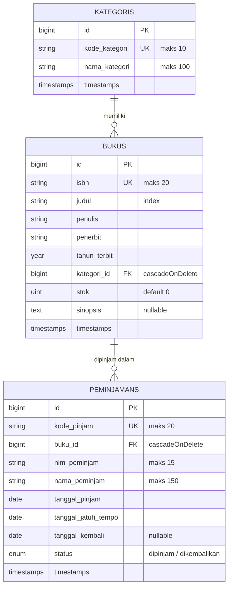

Tabel pendukung: `users` (akun pustakawan), `sessions` (penyimpanan sesi, `SESSION_DRIVER=database`), dan `personal_access_tokens` (token Sanctum).

Relasi Eloquent:
- `Kategori` hasMany `Buku`; `Buku` belongsTo `Kategori`
- `Buku` hasMany `Peminjaman`; `Peminjaman` belongsTo `Buku`

---

## 5. Bukti Eager Loading (N+1), Minggu 5

Listener `DB::listen` di `AppServiceProvider` mencatat setiap kueri ke `storage/logs/laravel.log`.
Cuplikan log tersedia di `docs/sql-audit-eager-loading.log`.

Halaman `/buku` memakai `Buku::with('kategori')->withCount('peminjamans')` dengan paginasi:
- 1 kueri `count` (pagination)
- 1 kueri daftar buku
- 1 kueri kategori (`where id in (...)`), bukan 1 kueri per buku

Perbandingan di tinker: lazy loading menghasilkan 20 kueri (1 kueri `bukus` + 19 kueri `kategoris`), sedangkan eager loading (`Buku::with('kategori')->get()`) hanya 2 kueri.

---

## 6. Transaksi ACID & Concurrency Locking

Logika web ada di `app/Http/Controllers/PeminjamanController.php`. Versi REST ada di `app/Http/Controllers/Api/V1/PeminjamanApiController.php`.

### Peminjaman buku (`pinjam`)

Seluruh proses dibungkus `DB::transaction()` dan baris buku dikunci dengan `lockForUpdate()` (`SELECT ... FOR UPDATE`) supaya permintaan paralel mengantre dan stok tidak bisa menjadi minus.

1. Kunci baris buku: `Buku::where('id', $id)->lockForUpdate()->firstOrFail()`
2. Jika `stok < 1`, transaksi dibatalkan dan peminjaman ditolak.
3. Jika NIM yang sama masih meminjam buku yang sama (`status = dipinjam`), ditolak dengan 409.
4. `$buku->decrement('stok')`
5. Catat ke tabel `peminjamans` (kode `PJM-YYYYMMDD-XXXXX`).

### Pengembalian buku (`kembali`)

Memakai `DB::transaction()` + `lockForUpdate()` pada baris peminjaman dan buku:

1. Tolak jika status sudah `dikembalikan`.
2. Ubah status menjadi `dikembalikan` dan isi `tanggal_kembali`.
3. `$buku->increment('stok')`

### Penanganan galat

- Pesan bisnis ditampilkan sebagai flash message (web) atau RFC 7807 (API).
- `QueryException` dicatat ke `Log::error()` dan pengguna melihat pesan umum.

---

## 7. Query Builder, `withCount`, & Filter Dinamis

- **Kartu statistik** (`DB::table()`): Total Judul Buku, Total Stok Tersedia (`sum('stok')`), Total Sedang Dipinjam, Total Dikembalikan.
- **Katalog buku**: `Buku::with('kategori')->withCount('peminjamans')` sehingga jumlah peminjaman tampil tanpa N+1 query.
- **Pencarian dinamis** dengan `when()` (judul / penulis / ISBN dan filter kategori) serta paginasi `withQueryString()`.

---

## 8. Manajemen Sesi, Cookie, & Autentikasi

Logika web ada di `app/Http/Controllers/AuthController.php`.

| Aspek | Implementasi |
|---|---|
| Login | `Auth::attempt()`, opsi "Ingat saya" |
| Anti Session Fixation | `$request->session()->regenerate()` saat login |
| Session state | `login_timestamp` (ditampilkan di navbar), `last_peminjam` |
| HTTP Cookie | `Cookie::queue('del_last_user_email', ..., 10080)` (7 hari), dipakai untuk mengisi otomatis email di form login |
| Logout | `Auth::logout()`, `session()->invalidate()`, `session()->regenerateToken()` |
| Proteksi rute web | Middleware `auth` pada rute mutasi (CRUD buku/kategori, peminjaman, pengembalian) |
| Proteksi rute API | Middleware `auth:sanctum` dengan Bearer Token (stateless) |

---

## 9. Seeder & Data Uji

`php artisan migrate:fresh --seed` menyiapkan:
- akun pustakawan (lihat bagian 1)
- kategori dan buku sampel (Faker)
- buku **stok = 0** ("Algoritma dan Struktur Data (Stok Habis)") untuk uji penolakan
- buku **stok = 1** ("Basis Data Lanjut (Stok Tinggal 1)") untuk uji batas stok
- sampel transaksi peminjaman (sedang dipinjam dan sudah dikembalikan)

---

## 10. Bukti Pengujian Minggu 6

### 10.1 Proteksi rute & login
Mengakses `/buku/create` tanpa login dialihkan ke `/login`.

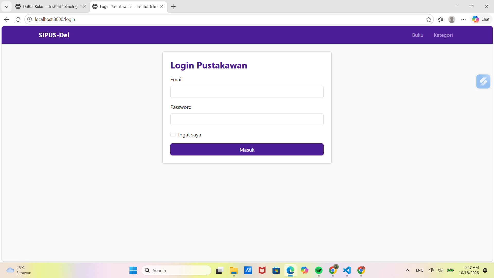

Setelah login berhasil, pengguna kembali ke halaman tujuan dan flash message "Sesi Anda telah aktif." tampil.

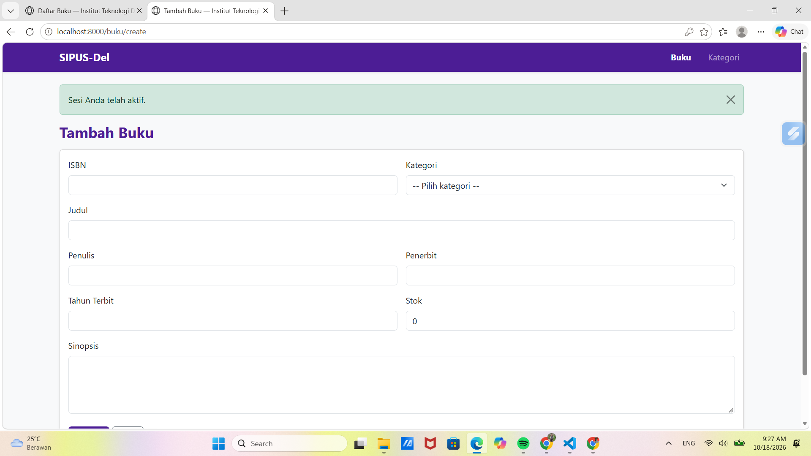

Navbar menampilkan nama pustakawan, waktu login (zona waktu Asia/Jakarta), dan tombol Logout.

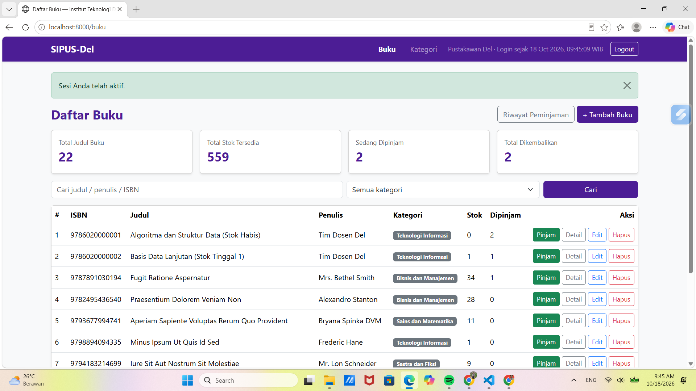

### 10.2 Peminjaman buku stok = 0 ditolak (rollback)


### 10.3 Pengembalian dan peminjaman berhasil
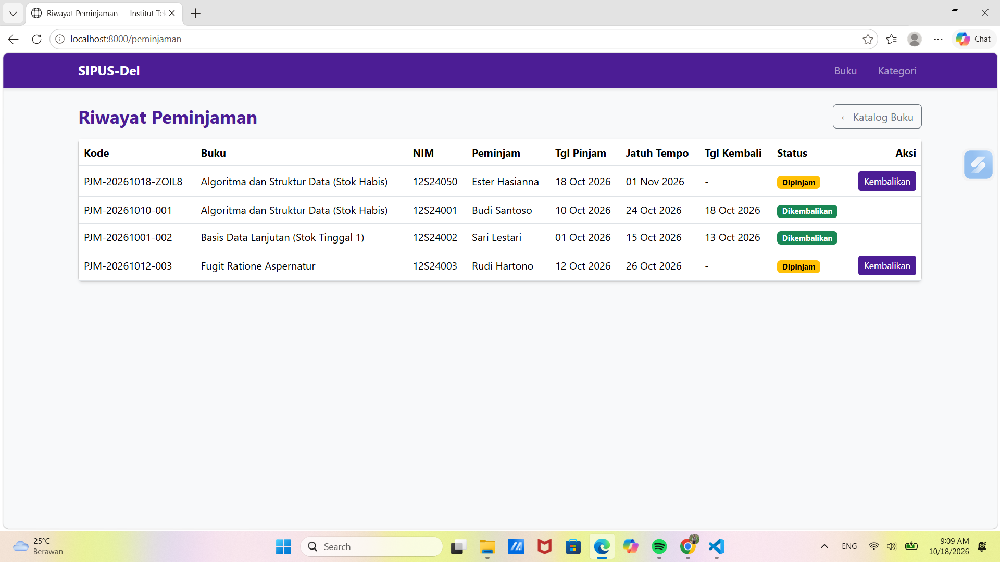

### 10.4 NIM yang sama meminjam buku yang sama ditolak
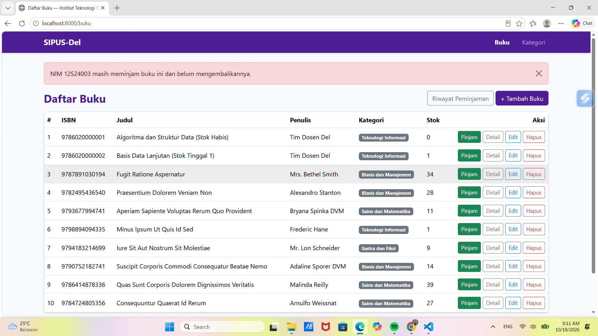

### 10.5 Riwayat peminjaman
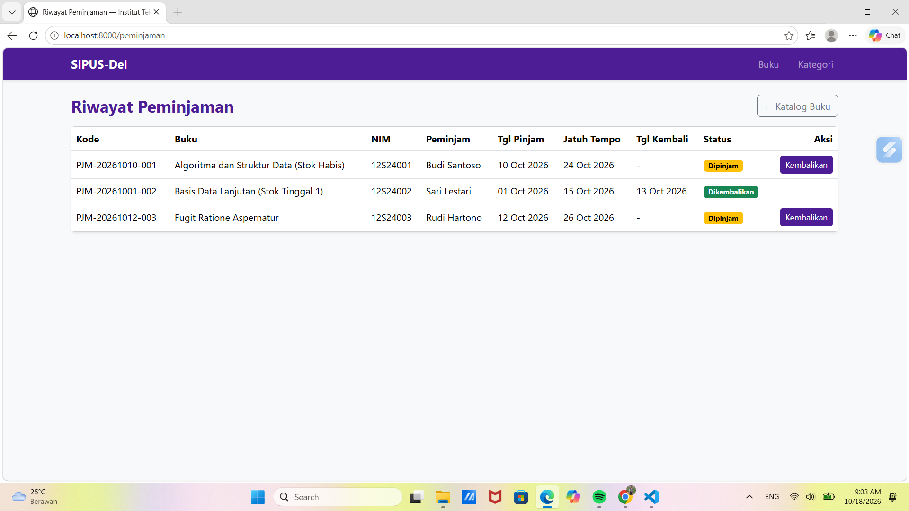

### 10.6 Statistik Query Builder & `withCount`
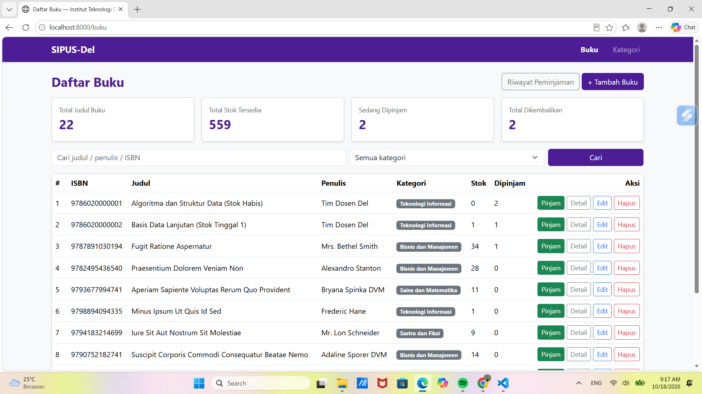

### 10.7 Pencarian dinamis (`when()`)
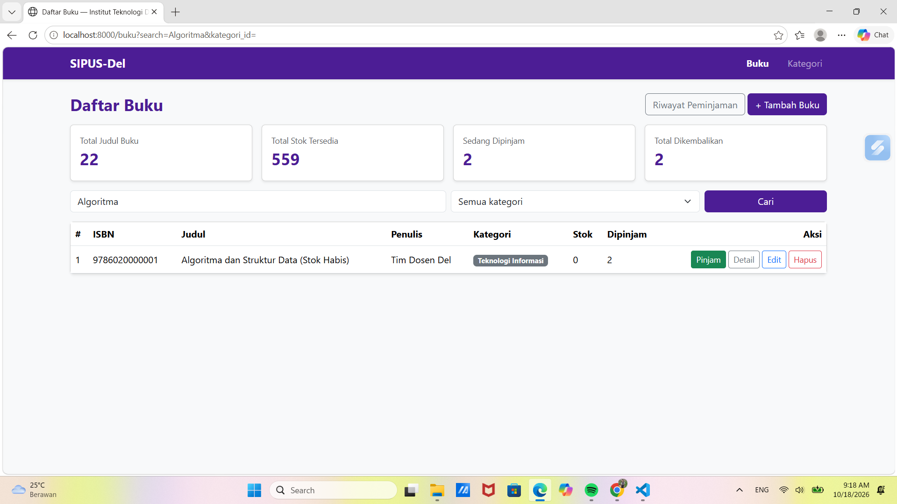

### 10.8 Audit Cookie pada Browser DevTools
Cookie sesi dan `del_last_user_email` bertanda **HttpOnly** dengan **SameSite=Lax**.

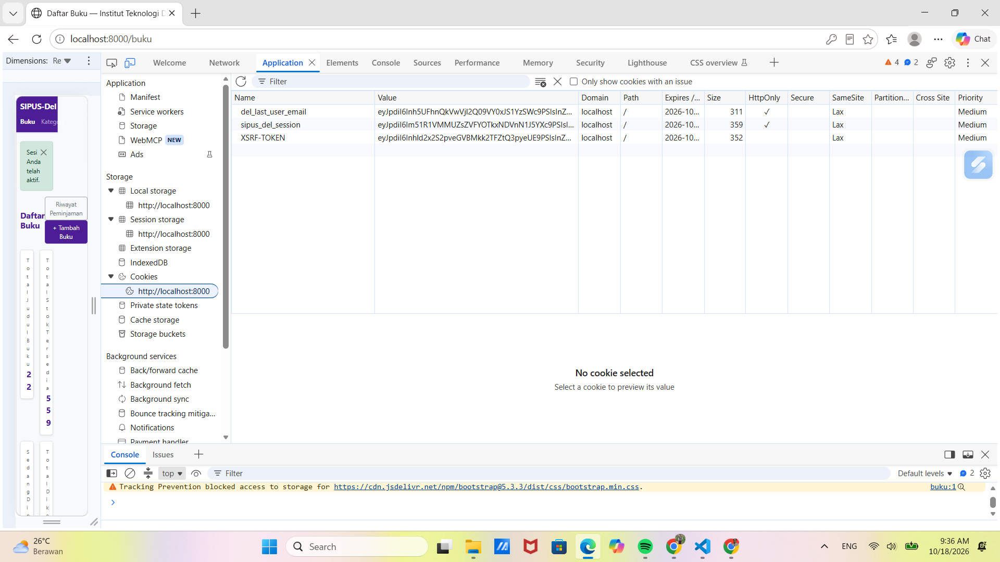

### 10.9 Logout & invalidasi sesi
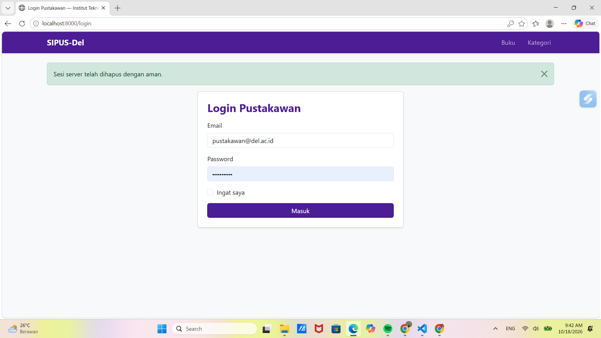

---

## 11. Analisis Kelayakan Web Services (Minggu 9)

### 11.1 Peran Provider dan Consumer di SIPUS-Del

| Peran | Contoh di SIPUS-Del |
|---|---|
| **Service Provider** | SIPUS-Del menyediakan REST API v1 untuk katalog buku, peminjaman, dan pengembalian, serta layanan SOAP `CheckClearanceStatus` untuk sistem Administrasi Yudisium (legacy). |
| **Service Consumer** | Aplikasi mobile dan kiosk mandiri memanggil REST API. Sistem legacy Yudisium memanggil SOAP. |

### 11.2 Mengapa REST dipilih untuk mobile dan kiosk, bukan SOAP

| Aspek | SOAP | REST (JSON) |
|---|---|---|
| Ukuran payload | XML verbose, boros bandwidth | JSON ringkas |
| Kontrak | File WSDL wajib | OpenAPI 3.0 |
| Autentikasi | WS-Security (kompleks) | Bearer Token (sederhana, stateless) |
| Dukungan klien | Butuh library SOAP | Native di JavaScript, Dart, Kotlin, PHP |
| Semantik | Satu endpoint POST, operasi di dalam body | Verb HTTP dan status code yang eksplisit |

Untuk aplikasi mobile dan kiosk yang memerlukan respons cepat, bandwidth terbatas, dan integrasi mudah, REST dengan JSON lebih sesuai. SOAP tetap dipertahankan karena sistem legacy Yudisium masih membutuhkannya.

---

## 12. Katalog Endpoint Web Services

### 12.1 SOAP (legacy)

| Method | URI | Auth | Deskripsi | Kode Status |
|---|---|---|---|---|
| GET | `/soap/sipus.wsdl` | Publik | Kontrak WSDL operasi `CheckClearanceStatus` | 200 |
| POST | `/soap/sipus` | Publik | Cek jumlah pinjaman aktif dan status bebas pustaka per `nim_peminjam` | 200, 500 (`<soap:Fault>`) |

### 12.2 REST API v1

| Method | URI | Auth | Deskripsi | Kode Status |
|---|---|---|---|---|
| POST | `/api/v1/auth/login` | Publik | Login dan terbitkan Bearer Token | 200, 401, 422 |
| GET | `/api/v1/auth/me` | Bearer | Profil pemilik token | 200, 401 |
| POST | `/api/v1/auth/logout` | Bearer | Cabut token aktif | 200, 401 |
| GET | `/api/v1/bukus` | Publik | Katalog terpaginasi dengan filter dan sort | 200 |
| GET | `/api/v1/bukus/{id}` | Publik | Detail buku, kategori, riwayat peminjaman, HATEOAS | 200, 404 |
| POST | `/api/v1/bukus` | Bearer | Tambah buku | 201 + Location, 401, 422 |
| PUT | `/api/v1/bukus/{id}` | Bearer | Penggantian penuh | 200, 401, 404, 422 |
| PATCH | `/api/v1/bukus/{id}` | Bearer | Pembaruan parsial | 200, 400, 401, 404, 422 |
| DELETE | `/api/v1/bukus/{id}` | Bearer | Hapus buku, ditolak jika masih dipinjam | 204, 401, 404, 409 |
| GET | `/api/v1/peminjamans` | Bearer | Daftar peminjaman terpaginasi | 200, 401 |
| POST | `/api/v1/peminjamans` | Bearer | Catat peminjaman (ACID) | 201 + Location, 401, 409, 422 |
| PATCH | `/api/v1/peminjamans/{id}/kembalikan` | Bearer | Kembalikan buku (ACID) | 200, 401, 404, 409 |

Semua galat `/api/*` berformat `application/problem+json` (RFC 7807).

---

## 13. Bukti Pengujian Minggu 9

Pengujian dilakukan di Postman dengan `php artisan serve` pada `http://localhost:8000`. Token pada screenshot sudah disensor.

**(a) SOAP: WSDL (GET, 200)**

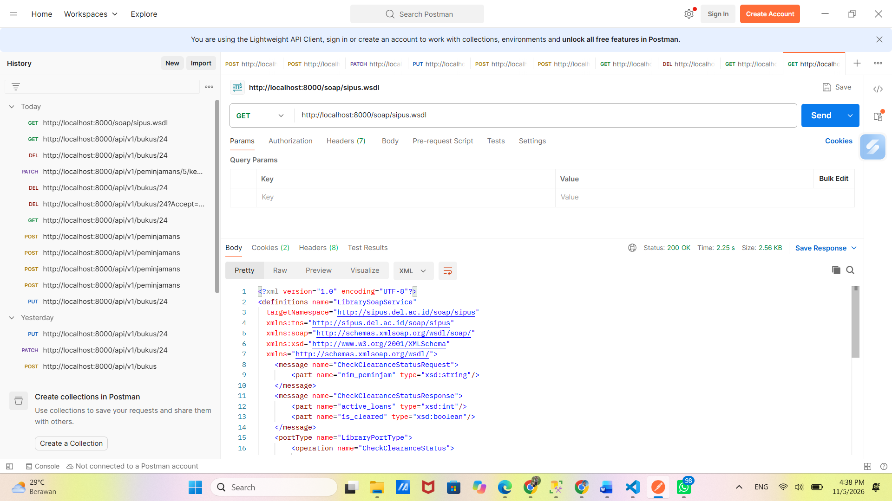

**(b) SOAP: sukses (POST, 200), `active_loans` 0 dan `is_cleared` true**

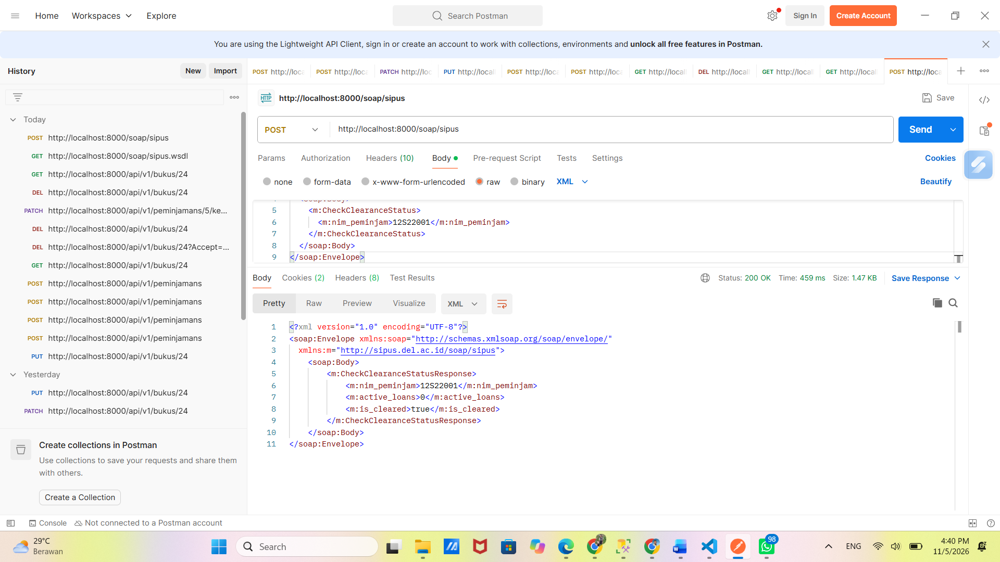

**(c) SOAP Fault: NIM kosong (POST, 500, `faultcode` soap:Client)**

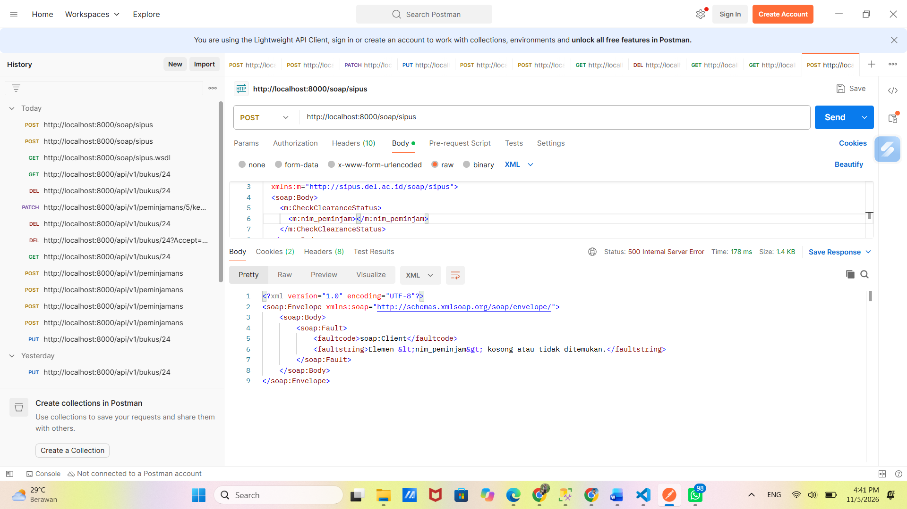

**(d) Login Bearer Token (POST, 200)**

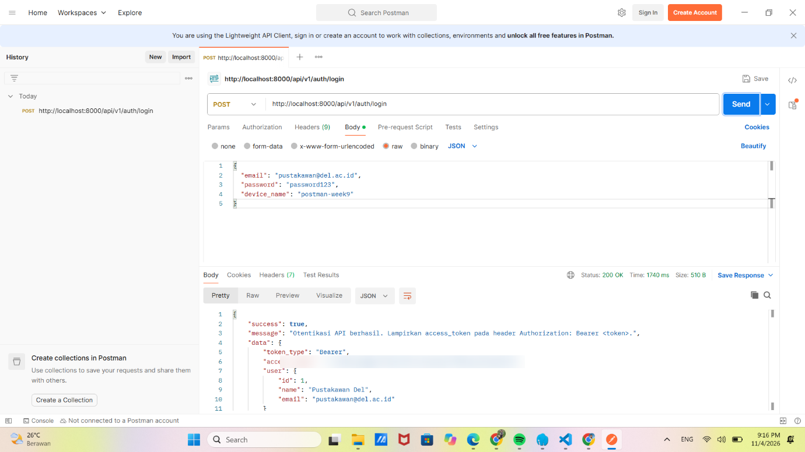

**(e) POST buku 201 dengan header Location**

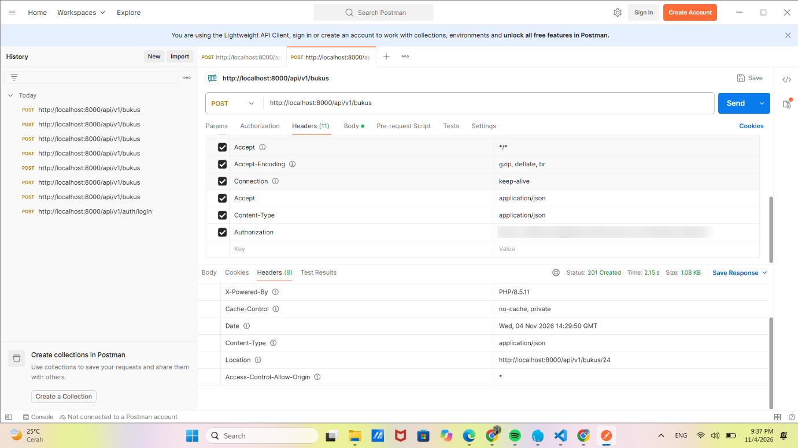

**(f) PUT: sinopsis yang tidak dikirim menjadi null (200)**

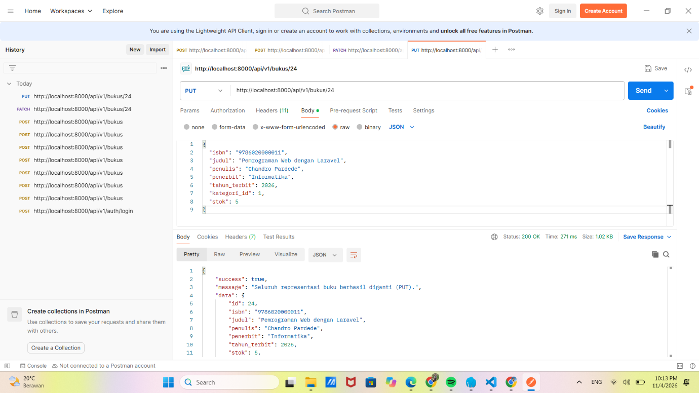

**(g) Peminjaman sukses (POST, 201), stok berkurang**

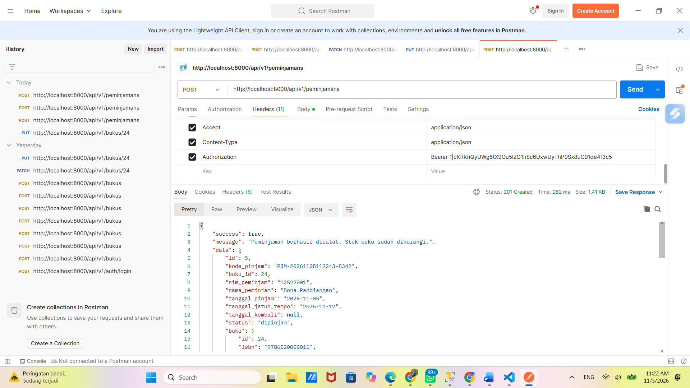

**(h) Peminjaman ganda ditolak (POST, 409 Conflict, RFC 7807)**

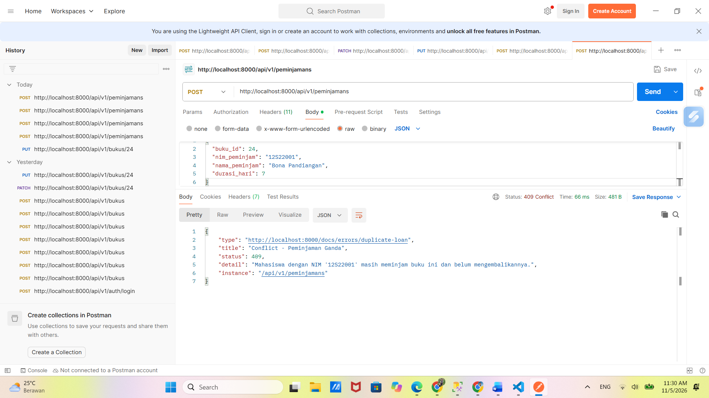

**(i) Hapus buku yang masih dipinjam ditolak (DELETE, 409)**

Response `title` "Conflict - Buku Sedang Dipinjam" dengan `detail` yang menyebut 1 peminjaman aktif.

**(j) Kembalikan buku (PATCH, 200), hapus buku (DELETE, 204), dan GET setelahnya (404)**

PATCH `/api/v1/peminjamans/5/kembalikan` menghasilkan status `dikembalikan`, DELETE `/api/v1/bukus/24` menghasilkan 204 No Content, dan GET `/api/v1/bukus/24` menghasilkan 404 Not Found.

---

## 14. Struktur

- Model: `app/Models` (Buku, Kategori, Peminjaman, User)
- Controller web: `app/Http/Controllers` (BukuController, KategoriController, PeminjamanController, AuthController)
- Controller API: `app/Http/Controllers/Api/V1` (AuthTokenController, BukuApiController, PeminjamanApiController)
- Controller SOAP: `app/Http/Controllers/Soap` (LibrarySoapController)
- Resource: `app/Http/Resources` (BukuResource, PeminjamanResource)
- Trait respons: `app/Traits/ApiResponse.php`
- Rute: `routes/web.php` (web dan SOAP), `routes/api.php` (REST v1)
- Migrasi, Factory, Seeder: `database/`
- Kontrak & koleksi: `docs/openapi-sipus-v1.yaml`, `docs/SIPUS-Del-APIv1.postman_collection.json`
- Dokumentasi & bukti: `docs/`

---

## 15. Konvensi Commit

Minggu 6:
```text
feat(migration): create peminjamans table with foreign key to bukus
feat(transaction): implement ACID book borrowing and return with lockForUpdate
feat(query-builder): add library analytics dashboard and dynamic search
feat(auth-session): implement librarian login, session regeneration, and cookies
```

Minggu 9:
```text
feat(soap): add concise LibrarySoapController and WSDL contract for clearance check
feat(api-core): install laravel api routing, ApiResponse trait, and RFC 7807 exception handler
feat(api-auth): implement stateless Sanctum bearer token login and revocation
feat(api-books): build BukuApiController and BukuResource with dynamic HATEOAS links
feat(api-loans): implement ACID book borrowing and return REST endpoints with lockForUpdate
docs(contract): add OpenAPI 3.0 specification, Postman collection, and test report in README
```
