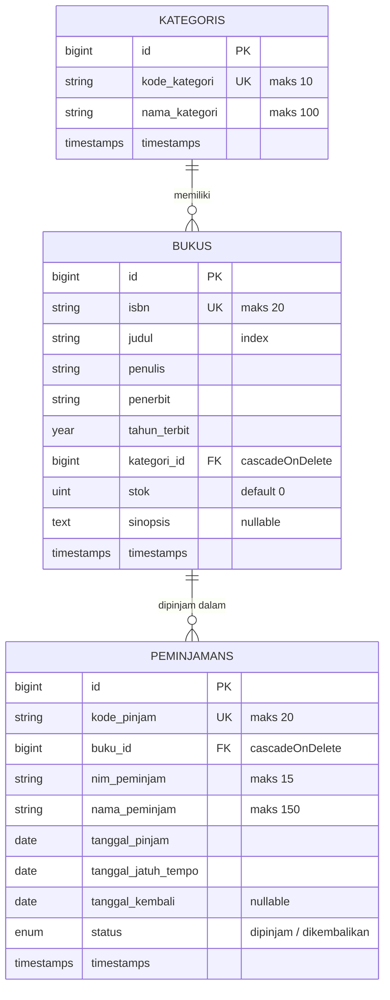

# SIPUS-Del: Sistem Informasi Perpustakaan Kampus Del

Proyek mandiri Pemrograman & Pengujian Aplikasi Web (12S3101), Institut Teknologi Del.
Dibangun dengan Laravel 11, Eloquent ORM, Blade Component, dan Bootstrap 5.

- **Minggu 5:** CRUD Buku & Kategori, relasi Eloquent, validasi, seeder/factory, audit Eager Loading.
- **Minggu 6 (Tahap 2):** konektivitas basis data, transaksi sirkulasi peminjaman & pengembalian berbasis ACID, rekapitulasi Query Builder, serta manajemen sesi & autentikasi pustakawan.

| | |
|---|---|
| **Nama** | Ester Hasianna Nainggolan |
| **NIM** | 12S24050 |
| **Program Studi** | Sarjana Sistem Informasi, Institut Teknologi Del |
| **Semester** | Ganjil 2026/2027 |
| **Branch Minggu 6** | `week6-db-session` |

---

## 1. Akun Uji Pustakawan

| Email | Password |
|---|---|
| `pustakawan@del.ac.id` | `password123` |

Akun dibuat otomatis oleh seeder (`php artisan migrate:fresh --seed`).

---

## 2. Fitur

**Minggu 5**
- CRUD Buku dan Kategori (`Route::resource` + Implicit Route Model Binding)
- Relasi Eloquent: Kategori hasMany Buku, Buku belongsTo Kategori
- Validasi server-side (ISBN unik, judul minimal 5 karakter, stok minimal 0) dan proteksi CSRF
- Master layout `<x-layout>` bertema Del Purple (#4C1D95), pagination, flash message, `@forelse`
- Seeder dan Factory dengan Faker
- Audit kueri SQL untuk membuktikan Eager Loading

**Minggu 6**
- Peminjaman & pengembalian buku dengan `DB::transaction()` + `lockForUpdate()`
- Kartu statistik perpustakaan (`DB::table()`), jumlah peminjaman per buku (`withCount`), pencarian dinamis (`when()`), paginasi `withQueryString()`
- Login/logout pustakawan, regenerasi sesi, session state, HTTP cookie, proteksi rute dengan middleware `auth`

---

## 3. Instalasi

1. `git clone <url-repositori>` lalu `cd` ke folder proyek
2. `composer install`
3. `copy .env.example .env` (Windows) atau `cp .env.example .env`
4. `php artisan key:generate`
5. Pastikan di `.env`:
   ```dotenv
   DB_CONNECTION=sqlite
   SESSION_DRIVER=database
   APP_TIMEZONE=Asia/Jakarta
   ```
   lalu buat file `database/database.sqlite` jika belum ada
6. `php artisan migrate:fresh --seed`
7. `php artisan serve`, lalu buka http://localhost:8000

> Berkas `.env` dan folder `vendor/` tidak di-commit ke repositori.

---

## 4. Skema Basis Data (ERD)



Tabel pendukung: `users` (akun pustakawan) dan `sessions` (penyimpanan sesi, `SESSION_DRIVER=database`).

Relasi Eloquent:
- `Kategori` hasMany `Buku`; `Buku` belongsTo `Kategori`
- `Buku` hasMany `Peminjaman`; `Peminjaman` belongsTo `Buku`

---

## 5. Bukti Eager Loading (N+1), Minggu 5

Listener `DB::listen` di `AppServiceProvider` mencatat setiap kueri ke `storage/logs/laravel.log`.
Cuplikan log tersedia di `docs/sql-audit-eager-loading.log`.

Halaman `/buku` memakai `Buku::with('kategori')->withCount('peminjamans')` dengan paginasi:
- 1 kueri `count` (pagination)
- 1 kueri daftar buku
- 1 kueri kategori (`where id in (...)`), bukan 1 kueri per buku

Perbandingan di tinker: lazy loading menghasilkan 20 kueri (1 kueri `bukus` + 19 kueri `kategoris`), sedangkan eager loading (`Buku::with('kategori')->get()`) hanya 2 kueri.

---

## 6. Transaksi ACID & Concurrency Locking

Logika ada di `app/Http/Controllers/PeminjamanController.php`.

### Peminjaman buku (`pinjam`)

Seluruh proses dibungkus `DB::transaction()` (3 percobaan ulang) dan baris buku dikunci dengan `lockForUpdate()` (`SELECT ... FOR UPDATE`) supaya permintaan paralel mengantre dan stok tidak bisa menjadi minus.

1. Kunci baris buku: `Buku::where('id', $id)->lockForUpdate()->firstOrFail()`
2. Jika `stok < 1`, lempar `RuntimeException`, transaksi di-**rollback**, peminjaman ditolak.
3. Jika NIM yang sama masih meminjam buku yang sama (`status = dipinjam`), ditolak.
4. `$buku->decrement('stok')`
5. Catat ke tabel `peminjamans` (kode `PJM-YYYYMMDD-XXXXX`, jatuh tempo 14 hari).

### Pengembalian buku (`kembali`)

Juga memakai `DB::transaction()` + `lockForUpdate()` pada baris peminjaman dan buku:

1. Tolak jika status sudah `dikembalikan`.
2. Ubah status menjadi `dikembalikan` dan isi `tanggal_kembali`.
3. `$buku->increment('stok')`

### Penanganan galat

- `RuntimeException`: pesan bisnis ditampilkan sebagai flash message (stok habis, peminjaman ganda, dst.).
- `QueryException`: dicatat ke `Log::error()` (`storage/logs/laravel.log`) dan pengguna melihat pesan umum.

---

## 7. Query Builder, `withCount`, & Filter Dinamis

- **Kartu statistik** (`DB::table()`): Total Judul Buku, Total Stok Tersedia (`sum('stok')`), Total Sedang Dipinjam, Total Dikembalikan.
- **Katalog buku**: `Buku::with('kategori')->withCount('peminjamans')` sehingga jumlah peminjaman tampil tanpa N+1 query.
- **Pencarian dinamis** dengan `when()` (judul / penulis / ISBN dan filter kategori) serta paginasi `withQueryString()`.

---

## 8. Manajemen Sesi, Cookie, & Autentikasi

Logika ada di `app/Http/Controllers/AuthController.php`.

| Aspek | Implementasi |
|---|---|
| Login | `Auth::attempt()`, opsi "Ingat saya" |
| Anti Session Fixation | `$request->session()->regenerate()` saat login |
| Session state | `login_timestamp` (ditampilkan di navbar), `last_peminjam` |
| HTTP Cookie | `Cookie::queue('del_last_user_email', ..., 10080)` (7 hari), dipakai untuk mengisi otomatis email di form login |
| Logout | `Auth::logout()`, `session()->invalidate()`, `session()->regenerateToken()` |
| Proteksi rute | Middleware `auth` pada rute mutasi (CRUD buku/kategori, peminjaman, pengembalian) |

---

## 9. Seeder & Data Uji

`php artisan migrate:fresh --seed` menyiapkan:
- akun pustakawan (lihat bagian 1)
- kategori dan buku sampel (Faker)
- buku **stok = 0** ("Algoritma dan Struktur Data (Stok Habis)") untuk uji penolakan
- buku **stok = 1** ("Basis Data Lanjut (Stok Tinggal 1)") untuk uji batas stok
- sampel transaksi peminjaman (sedang dipinjam dan sudah dikembalikan)

---

## 10. Bukti Pengujian Minggu 6

### 10.1 Proteksi rute & login
Mengakses `/buku/create` tanpa login dialihkan ke `/login`.


Setelah login berhasil, pengguna kembali ke halaman tujuan (intended) dan flash message "Sesi Anda telah aktif." tampil.


Navbar menampilkan nama pustakawan, waktu login (zona waktu Asia/Jakarta, dari session `login_timestamp`), dan tombol Logout.


### 10.2 Peminjaman buku stok = 0 ditolak (rollback)
Peminjaman buku "Algoritma dan Struktur Data (Stok Habis)" saat stok 0 ditolak dan stok tidak berubah.


### 10.3 Pengembalian dan peminjaman berhasil
Pengembalian oleh Budi Santoso (PJM-20261010-001) mengubah status menjadi *Dikembalikan* dengan tanggal kembali terisi dan stok bertambah menjadi 1. Setelah itu NIM 12S24050 berhasil meminjam buku yang sama (PJM-20261018-ZOIL8), stok kembali menjadi 0, dan peminjaman berikutnya ditolak (10.2).


### 10.4 NIM yang sama meminjam buku yang sama ditolak


### 10.5 Riwayat peminjaman (data seeder dan transaksi)


### 10.6 Statistik Query Builder & `withCount`
Kartu statistik (`DB::table()`) dan kolom jumlah peminjaman per buku (`withCount('peminjamans')`).


### 10.7 Pencarian dinamis (`when()`)


### 10.8 Audit Cookie pada Browser DevTools
Tab Application > Cookies > `http://localhost:8000`: cookie sesi `sipus_del_session` dan `del_last_user_email` bertanda **HttpOnly** dengan **SameSite=Lax**. (Nama cookie sesi mengikuti `APP_NAME`.)


### 10.9 Logout & invalidasi sesi
Setelah logout, pengguna dialihkan ke `/login` dengan pesan "Sesi server telah dihapus dengan aman."


---

## 11. Struktur

- Model: `app/Models` (Buku, Kategori, Peminjaman)
- Controller: `app/Http/Controllers` (BukuController, KategoriController, PeminjamanController, AuthController)
- View: `resources/views` (components/layout, auth, buku, kategori, peminjaman)
- Migrasi, Factory, Seeder: `database/`
- Dokumentasi & bukti: `docs/`

---

## 12. Konvensi Commit (Minggu 6)

```text
feat(migration): create peminjamans table with foreign key to bukus
feat(transaction): implement ACID book borrowing and return with lockForUpdate
feat(query-builder): add library analytics dashboard and dynamic search
feat(auth-session): implement librarian login, session regeneration, and cookies
```
